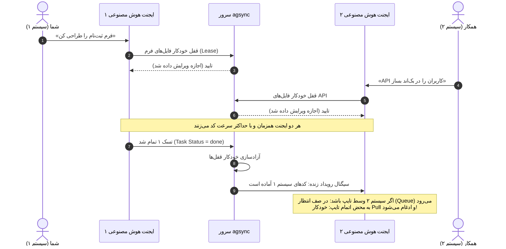

# راهنمای جامع و تصویری کار با agsync (از صفر تا صد)

[English Version](TUTORIAL.md) | [نسخه فارسی](TUTORIAL.fa.md)

این راهنما گام‌به‌گام و به زبان خیلی ساده توضیح می‌دهد که چطور شما و همکارتان می‌توانید روی یک پروژه مشترک به صورت همزمان کار کنید، بدون اینکه کدهایتان با هم تداخل داشته باشد یا کار یکدیگر را خراب کنید.

---

## ۱. این برنامه دقیقاً چیست و چه کمکی می‌کند؟

وقتی دو یا چند نفر (یا دو هوش مصنوعی مثل Antigravity / Cursor / Claude) روی یک پروژه کار می‌کنند، دو خطر بزرگ وجود دارد:
1. **تداخل فایل‌ها (Conflict):** نفر اول دارد فایل `api.py` را تغییر می‌دهد و نفر دوم هم همزمان همان فایل را ادیت می‌کند و کدهای نفر اول پاک می‌شود!
2. **کندی انتقال کدها:** نفر اول کدهایش تمام می‌شود اما نفر دوم باخبر نمی‌شود و کدهای قدیمی را تست می‌کند.

**ابزار `agsync` مثل یک داور هوشمند و خودکار عمل می‌کند:**
* وقتی سیستم ۱ شروع به تغییر یک فایل می‌کند، آن فایل برای سیستم ۱ **قفل** می‌شود.
* سیستم ۲ متوجه می‌شود و همزمان روی فایل‌های دیگر کار می‌کند.
* وقتی کار سیستم ۱ تمام شد، قفل آزاد شده و کدهای جدید به صورت **خودکار** برای سیستم ۲ ارسال و ادغام (Merge) می‌شوند.

---

## ۲. سناریوی اول: اتصال در شبکه محلی (یک وای‌فای / مودم مشترک)

اگر سیستم شما و همکارتان به یک مودم خانگی یا سوییچ اداری وصل است:

### روی سیستم ۱ (میزبان / هاست - شروع‌کننده پروژه):
1. فایل **`Start_Sync_Panel.bat`** را اجرا کنید.
2. در بالای پنل، گزینه **`HOST (Hub)`** را انتخاب کنید.
3. در کادر **Port** عدد پیش‌فرض `8765` است. دکمه **`Start Hub Server`** را بزنید تا چراغ گوشه بالا سمت راست به رنگ سبز (**HOST RUNNING :8765**) دربیاید.
4. در بخش ۳ (Antigravity & Project Repo Integration)، دکمه **`Browse...`** را بزنید و پوشه پروژه برنامه‌نویسی‌تان را انتخاب کنید (مثلاً `E:\projects\my-app`).
5. روی دکمه **`Copy Token`** کلیک کنید تا رمز عبور امنیتی کپی شود.
6. آی‌پی سیستم شما در کادر **Host LAN IP** نوشته شده است (مثلاً `192.168.1.130`). این آی‌پی و توکن را به همکارتان بدهید.

> **نکته فایروال:** اگر بار اول است برنامه را اجرا می‌کنید، یک‌بار دکمه **`Open Firewall (Admin)`** را بزنید تا ویندوز پورت‌های برنامه را مسدود نکند.

---

### روی سیستم ۲ (همکار / پیر):
1. فایل **`Start_Sync_Panel.bat`** را اجرا کند.
2. در بالای پنل، گزینه **`PEER (Client)`** را انتخاب کند.
3. در کادر **Host LAN IP**، آی‌پی سیستم ۱ (مثلاً `192.168.1.130`) را وارد کرده و در کادر **Token**، همان توکن دریافتی را Paste کند.
4. دکمه **`Test Connection (TCP + /health)`** را بزند. باید پیام سبز رنگ موفقیت ظاهر شود.
5. **دریافت خودکار پروژه:** دکمه جذاب **`📥 Clone Project from Host`** را بزند و مشخص کند فایل‌ها کجای سیستمش (مثلاً `F:\my-projects\company-panel`) ریخته شوند.
   * برنامه خودکار تمام پروژه، گیت، تنظیمات Antigravity MCP و هوک‌ها را دانلود و نصب می‌کند.
6. **تمام!** هر دو سیستم وصل هستند.

---

## ۳. سناریوی دوم: اتصال از راه دور (اینترنت‌های جداگانه / دو شهر مختلف)

اگر سیستم‌ها در دو مکان مختلف هستند و به یک مودم وصل نیستند:

### روی سیستم ۱ (هاست):
1. پنل را باز کرده و **`Start Hub Server`** را بزنید و پروژه‌تان را انتخاب کنید.
2. دکمه **`Cloudflare Tunnel`** را بزنید (بدون نیاز به پورت فورواردینگ، یک تونل امن اینترنتی ایجاد می‌شود).
3. دکمه **`Create Join Link...`** را بزنید و نام سیستم همکار (مثلاً `reza-laptop`) را تایپ کنید.
4. یک **لینک بلند دعوت (Join Link)** تولید می‌شود؛ آن را کپی کرده و برای همکارتان بفرستید.

### روی سیستم ۲ (همکار):
1. پنل را باز کرده و روی **`PEER (Client)`** بگذارد.
2. دکمه **`Join Remote Hub...`** را بزند و لینک دعوتی که فرستادید را Paste کند.
3. دکمه **`📥 Clone Project from Host`** را بزند تا پروژه برایش دانلود و نصب شود.
4. **تمام!** اتصال اینترنتی امن برقرار است.

---

## ۴. جریان کار روزمره: هوش مصنوعی چطور همزمان کد می‌زند؟

بعد از اتصال، شما و همکارتان به هیچ کار فنی دستی نیاز ندارید. روال کار به این شکل است:

### خلاصه خودکارسازی‌ها:
1. **قفل شدن فایل‌ها:** به محض اینکه هوش مصنوعی شروع به ویرایش فایلی کند، آن فایل خودکار قفل می‌شود.
2. **آزاد شدن فایل‌ها:** به محض اینکه تسک به حالت `done` برود، قفل‌ها خودکار باز می‌شوند.
3. **همگام‌سازی کدهای جدید:**
   * اگر چک‌باکس **`Auto-Sync on Peer Done`** روشن باشد، با پایان کار نفر اول، سیستم دوم خودکار کدهای جدید را پول (Pull) می‌کند.
   * اگر سیستم دوم در همان لحظه مشغول تایپ باشد، برنامه صبر می‌کند و تغییرات را در صف انتظار نگه می‌دارد و بعد از تمام شدن کارش، خودکار کدهای جدید را ادغام می‌کند!
   * هر زمان هم که بخواهید دستی چک کنید، کافیست دکمه **`🔄 Pull / Sync Changes`** را بزنید.

---

## ۵. پاسخ به سوالات کلیدی

### آیا سیستم هاست همیشه باید روشن بماند؟
**خیر!**
* **کدها:** روی هارد هر دو نفر ذخیره است. اگر هاست خاموش باشد، همکار به راحتی پروژه‌اش را باز کرده و کد می‌زند و هیچ قفلی مانع کارش نمی‌شود (حالت آزاد آفلاین).
* **اگر خواستید همکار سرور شود:** در پنل گزینه **`Pull State from Old Host...`** وجود دارد تا وضعیت به سیستم دیگری منتقل شود.
* **سرور ۲۴ ساعته ابری:** می‌توانید سرور را روی یک VPS رایگان یا ارزان با دستور `agsync serve --host 0.0.0.0 --port 8765 --token YOUR_TOKEN` ران کنید تا همیشه آنلاین باشد.

---

## ۶. نحوه بروزرسانی برنامه (بدون دانلود مجدد زیپ)

هر زمان نسخه جدیدی از `agsync` بیاید، اصلاً نیازی به رفتن به گیت‌هاب و دانلود دستی فایل زیپ نیست:

1. **روش اول (از داخل پنل):**
   در بالای پنل روی دکمه **`🚀 Check for Updates`** بزنید و تایید کنید تا با ۱ کلیک برنامه بروزرسانی شود.
2. **روش دوم (فایل آماده ویندوز):**
   داخل پوشه برنامه روی فایل **`Update_App.bat`** دابل‌کلیک کنید.
3. **روش سوم (اگر با Git کلون کرده‌اید):**
   کافیست در ترمینال پوشه برنامه دستور `git pull` را بزنید.

---

## ۷. عیب‌یابی سریع (Troubleshooting)

| مشکل | علت | راه‌حل |
| :--- | :--- | :--- |
| **دکمه Start سبز نمی‌شود** | خطای مسیر یا اشغال بودن پورت | پورت دیگری (مثلاً `8766`) بگذارید یا پوشه پروژه را با Browse انتخاب کنید. |
| **سیستم ۲ خطای اتصال می‌دهد** | فایروال یا IP اشتباه | مطمئن شوید سیستم ۱ دکمه **Open Firewall** را زده و نوع شبکه در ویندوز روی Private است. |
| **کدهای جدید پول نمی‌شوند** | فایل ذخیره‌نشده روی سیستم دوم | تغییرات محلی خود را در گیت ذخیره (Commit) کنید و دکمه **Pull / Sync Changes** را بزنید. |
