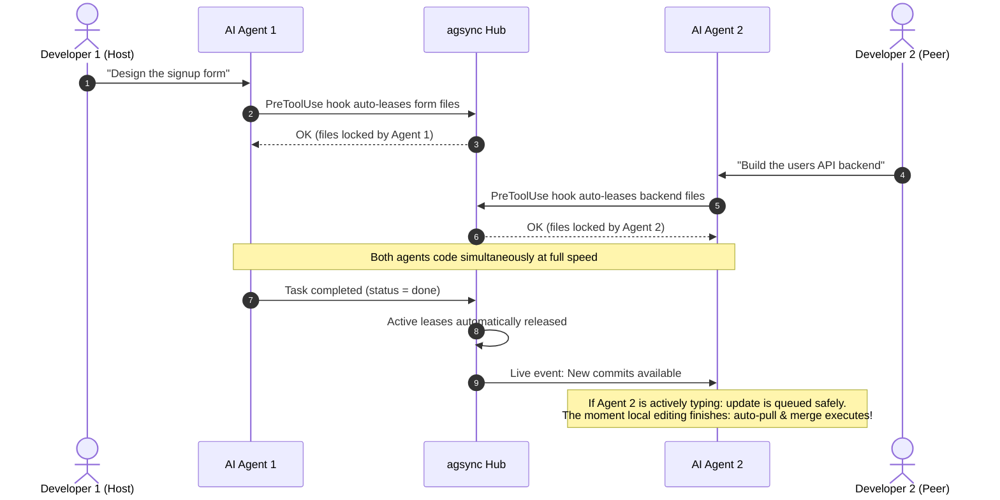

# Complete End-to-End Visual Guide to agsync

[English Version](TUTORIAL.md) | [نسخه فارسی](TUTORIAL.fa.md)

This step-by-step tutorial explains in plain, simple terms how you and your teammates can collaborate concurrently on a shared project with AI agents (Antigravity, Cursor, Claude) without merge conflicts or code overwrites.

---

## 1. What does agsync do?

When multiple developers or AI coding agents work on the same repository concurrently:
1. **File Overwrite Risk:** Agent 1 edits `api.py` while Agent 2 edits the same lines, causing lost work.
2. **Lag in Code Sharing:** Agent 1 completes a feature, but Agent 2 is working on stale, outdated code.

**`agsync` acts as an automated, real-time referee:**
* When Machine 1 starts editing a file, `agsync` automatically **leases (locks)** that file.
* Machine 2 sees the lock and works in parallel on independent files without blocking.
* When Machine 1 finishes its task, leases are released, and the newest code is **automatically pulled and merged** into Machine 2!

---

## 2. Scenario A: Local LAN Connection (Same Wi-Fi / Office Router)

### On Machine 1 (Host / Project Owner):
1. Double-click **`Start_Sync_Panel.bat`**.
2. Select **`HOST (Hub)`** at the top right.
3. Keep default port `8765` and click **`Start Hub Server`** (the status pill turns green: **HOST RUNNING :8765**).
4. Under section 3 (Antigravity & Project Repo Integration), click **`Browse...`** and select your local project folder (e.g. `E:\projects\my-app`).
5. Click **`Copy Token`** to copy your secure access token.
6. Note your IP shown in **Host LAN IP** (e.g. `192.168.1.130`). Share this IP and Token with your peer.

> **Windows Firewall Note:** If this is your first run, click **`Open Firewall (Admin)`** once to ensure Windows Defender allows LAN connections on port 8765.

---

### On Machine 2 (Peer / Teammate):
1. Double-click **`Start_Sync_Panel.bat`**.
2. Select **`PEER (Client)`** at the top right.
3. Enter Machine 1's IP in **Host LAN IP** (e.g. `192.168.1.130`) and paste the token into **Token**.
4. Click **`Test Connection (TCP + /health)`** to verify connectivity.
5. **1-Click Project Download:** Click **`📥 Clone Project from Host`** and select where on your local drive to place the project (e.g. `F:\projects\my-app`).
   * `agsync` downloads the complete project, git repository, Antigravity MCP configuration, and pre-commit safety hooks automatically!
6. **Done!** Both machines are connected and ready to code.

---

## 3. Scenario B: Remote Connection (Different Locations / Over the Internet)

If team members are in different locations without a shared local network:

### On Machine 1 (Host):
1. Open the panel, click **`Start Hub Server`**, and browse to select your project.
2. Click **`Cloudflare Tunnel`** (creates a secure, outbound-only tunnel without port-forwarding).
3. Click **`Create Join Link...`** and enter your peer's Agent ID (e.g. `peer-laptop`).
4. Copy the generated **Join Link** and send it to your teammate.

### On Machine 2 (Peer):
1. Open the panel and switch to **`PEER (Client)`**.
2. Click **`Join Remote Hub...`** and paste the Join Link.
3. Click **`📥 Clone Project from Host`** to download and configure the project.
4. **Done!** Remote synchronization is live.

---

## 4. Daily Workflow: Concurrent AI Coding with Zero Conflicts

Once connected, agents work concurrently with automated protection:

### Automation Summary:
1. **File Locking:** The moment an agent calls a file editing tool (`edit_file`, `write_file`), `agsync` automatically checks and locks the file.
2. **Lock Release:** When the task is marked `done`, active file leases are automatically released.
3. **Auto-Sync:**
   * When **`Auto-Sync on Peer Done`** is checked, finishing a task on one machine automatically triggers a pull on the other.
   * If the peer is currently typing, the sync is safely queued (Pending Sync) until local editing finishes.
   * You can also click **`🔄 Pull / Sync Changes`** anytime for an instant manual update.

---

## 5. Frequently Asked Questions

### Does the Host PC need to stay on 24/7?
**No!**
* **Project Files:** Stored locally on each developer's hard drive. If Host is offline, Peer can open, edit, test, and commit code without hindrance (fail-open offline mode).
* **Host Handoff:** Click **`Pull State from Old Host...`** to transfer the coordination state to another machine.
* **Always-On Cloud Hub:** You can run `agsync serve --host 0.0.0.0 --port 8765 --token YOUR_TOKEN` on a free or inexpensive cloud VPS (Railway, Render, Linux VPS) for a permanent 24/7 hub.

---

## 6. Updating agsync (No Manual ZIP Downloads)

1. **In-App 1-Click Update:** Click **`🚀 Check for Updates`** at the top of the Control Panel.
2. **Windows Batch:** Double-click **`Update_App.bat`** in the repository root.
3. **Git Clone:** Run `git pull` in your terminal.
